#  Tracker

**A focused home for testing a release: test plans, defects and the fix-and-verify loop,
in one place your QAs and developers share.**

QA Tracker is built for the engagement where a developer builds for a week or two and a
tester checks it for a few days. That's too small for a heavyweight test-management suite,
and too important for a spreadsheet and a chat thread. The test plan, the results, the
defects, the evidence and the conversation all live together, and the app keeps track of
who needs to do what next.

<p align="center">
  <a href="docs/getting-started.md"><strong>Get started</strong></a> ·
  <a href="docs/user-guide.md"><strong>Take the tour</strong></a> ·
  <a href="docs/features.md">All features</a> ·
  <a href="docs/README.md">Documentation</a>
</p>

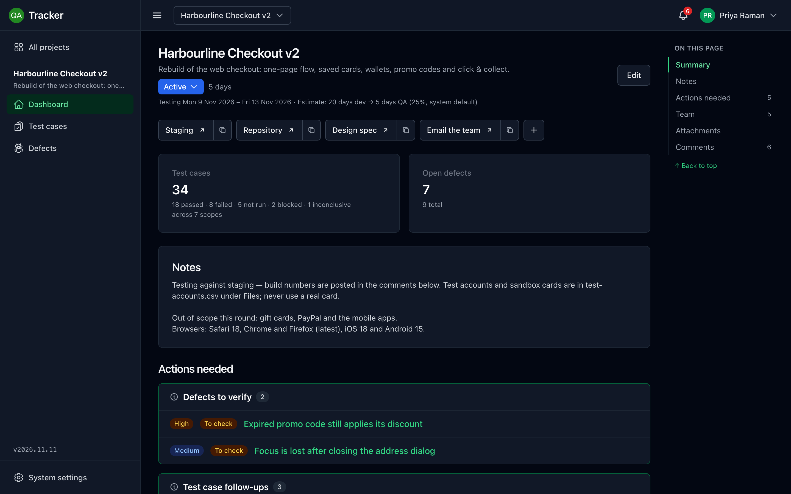

## Why teams use it

- **One place per engagement.** The plan, results, defects, files, links and discussion for
  a release sit together, so nobody has to ask "where are we?"
- **The fix-and-verify loop, built in.** A developer starts fixing and marks a defect fixed,
  it lands with a QA to check, and the QA closes it or sends it back. Every hand-off is
  recorded.
- **Always know what's next.** The dashboard lists what's waiting for you, Previous and
  Next step you through your queue, and the bell tells you when something lands on your
  desk.
- **History you can trust.** Every result, status change, assignment and file is stamped
  with who did it and when, on every test case and defect of every project you've run.
- **Yours to run.** It's one Docker container plus PostgreSQL. People sign in with Microsoft
  Entra ID, Keycloak or local accounts, and files go to S3 or Azure Blob Storage. It scales
  out without extra infrastructure.

## A quick tour

### Every project, past and present

Active work comes first, then what's coming up, then everything you've finished. Each
project shows its test results, the days of testing it has, and whether anything needs you.

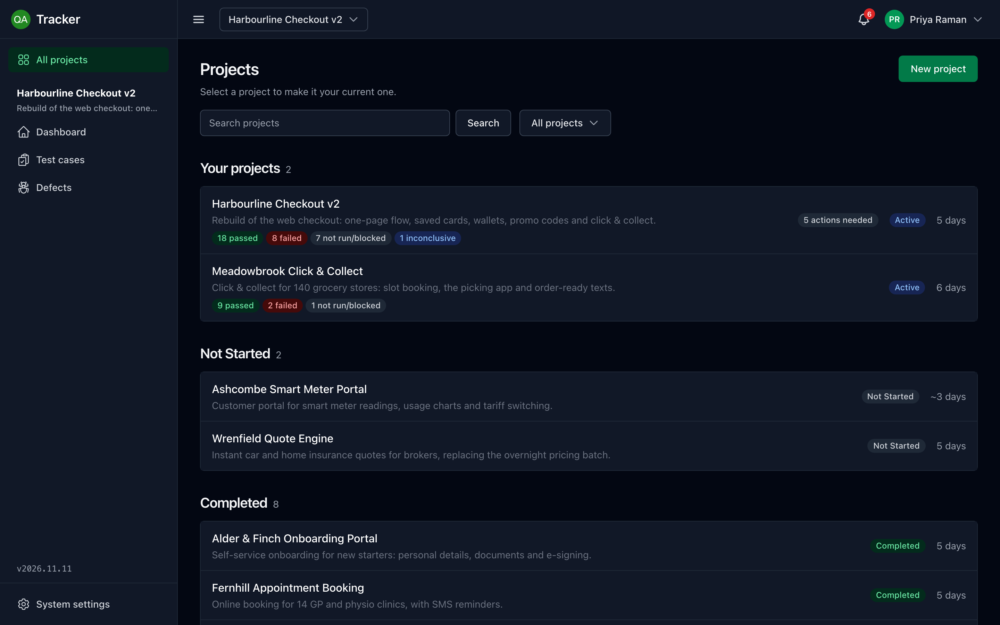

### Plan the testing

Group test cases into functional and non-functional scopes. Collapse the plan to see every
scope's progress at once, or expand it to pass and fail cases straight from the list.
Already have a plan in a spreadsheet? [Import it from CSV](docs/user-guide.md#import-a-plan-from-a-spreadsheet),
with a preview of exactly what will change.

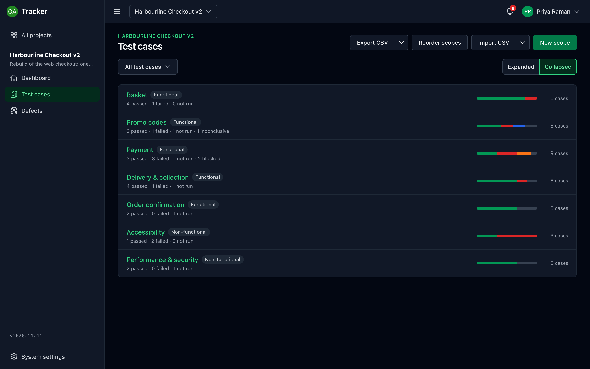

### Run tests, raise defects as you go

Each test case has its steps, a one-click result (Passed, Failed, Blocked or Inconclusive),
reference files, comments and linked defects. Raise a defect straight from a failed case,
with its steps filled in and the two linked for you.

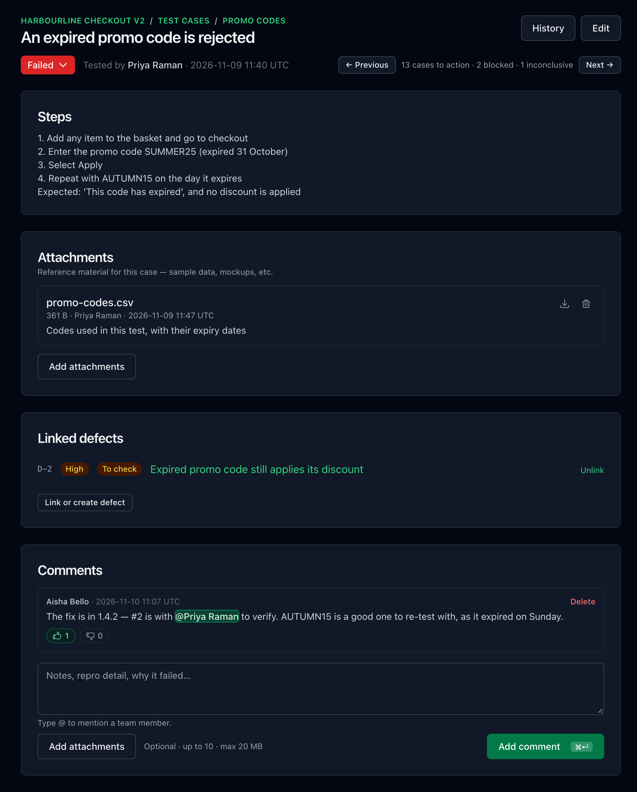

### Fix it, check it, close it

Developers see **Start fixing** and **Mark as fixed**. A fixed defect lands with a QA on the
team, who marks it **Fixed** or sends it back as **Not fixed**. Previous and Next step
through everything assigned to you, most severe first.

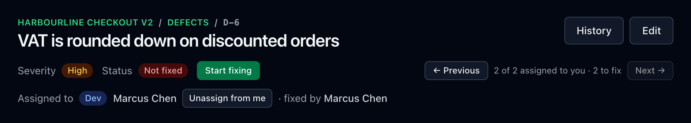
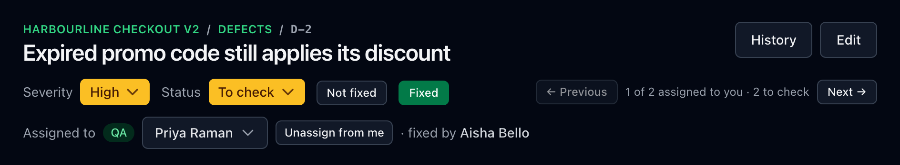

Every defect and test case keeps a full history:

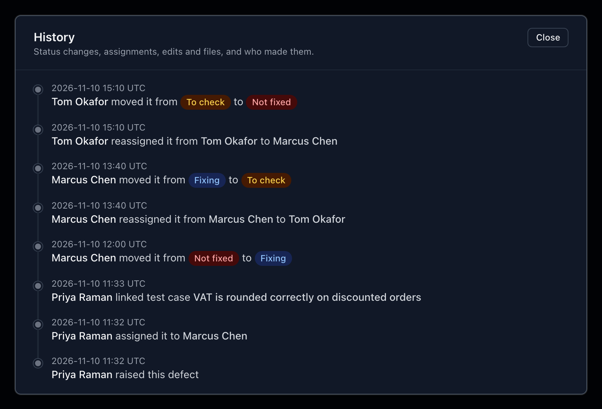

### Evidence where it belongs

Attach screenshots, recordings, logs and PDFs to projects, test cases, defects and
comments. Images, video, audio and PDFs open right in the app.

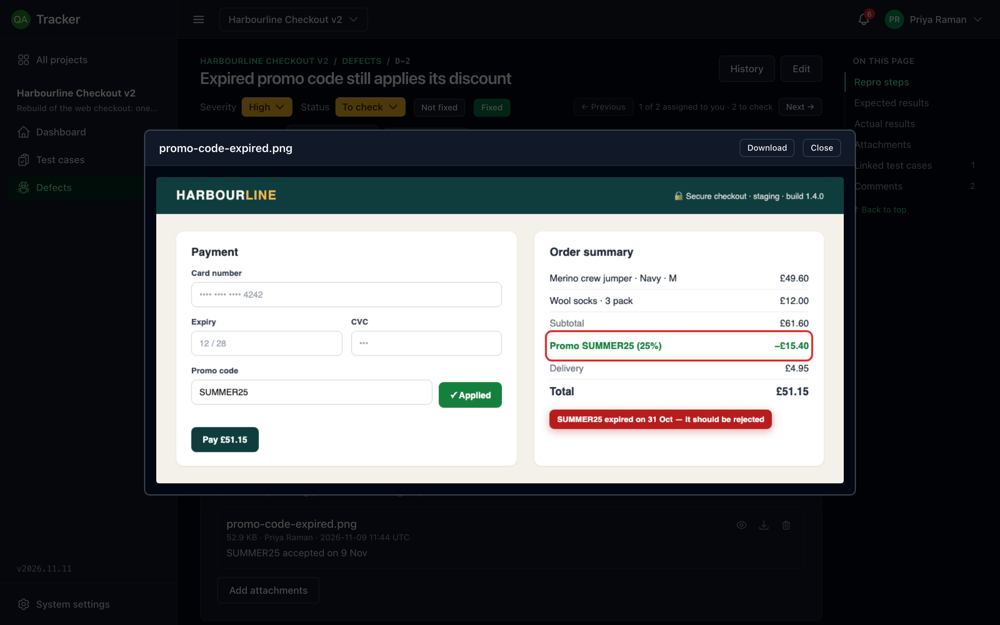

### Keep everyone in the loop

Comment on anything, @mention a teammate and react with a thumbs up. Mentions, hand-offs
and new defects arrive under the bell, with an optional sound.

<p align="center">
  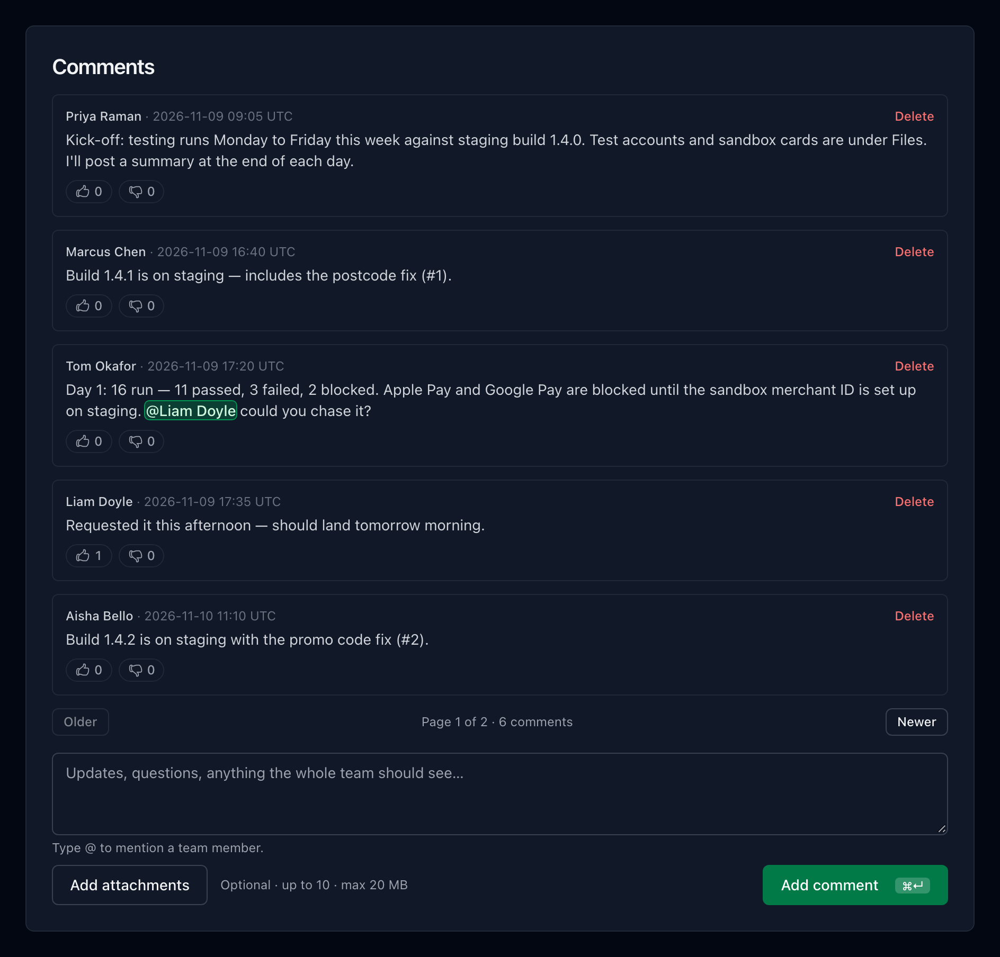
  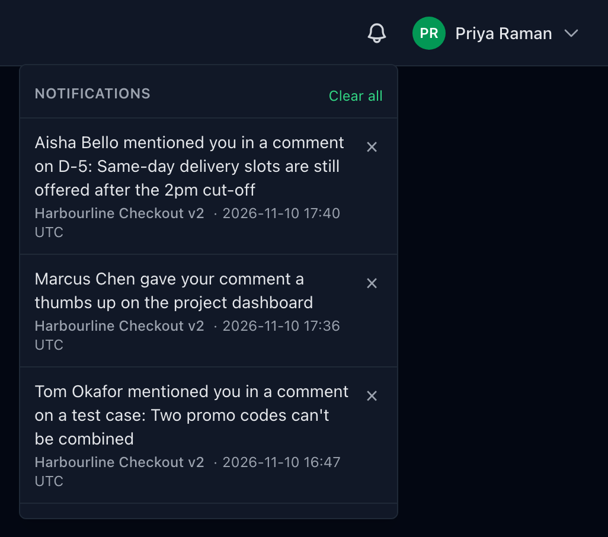
</p>

### Know what needs doing

The dashboard spells out what needs you: defects waiting for you to verify or fix, failed
tests with no defect raised, fixed defects whose tests are ready to re-run, and passed tests
that still have an open defect.

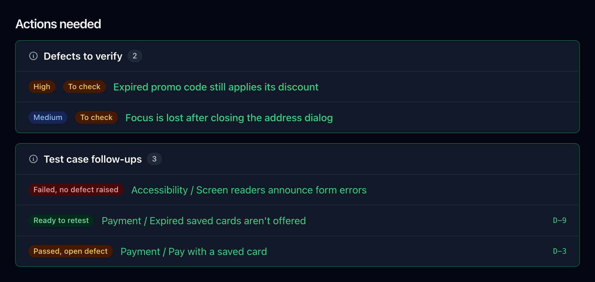

### Sign in with your company account

Use local accounts, add Microsoft Entra ID or Keycloak alongside them, or make single
sign-on the only way in. Roles come from your identity provider, and accounts are created
on first sign-in.

<p align="center">
  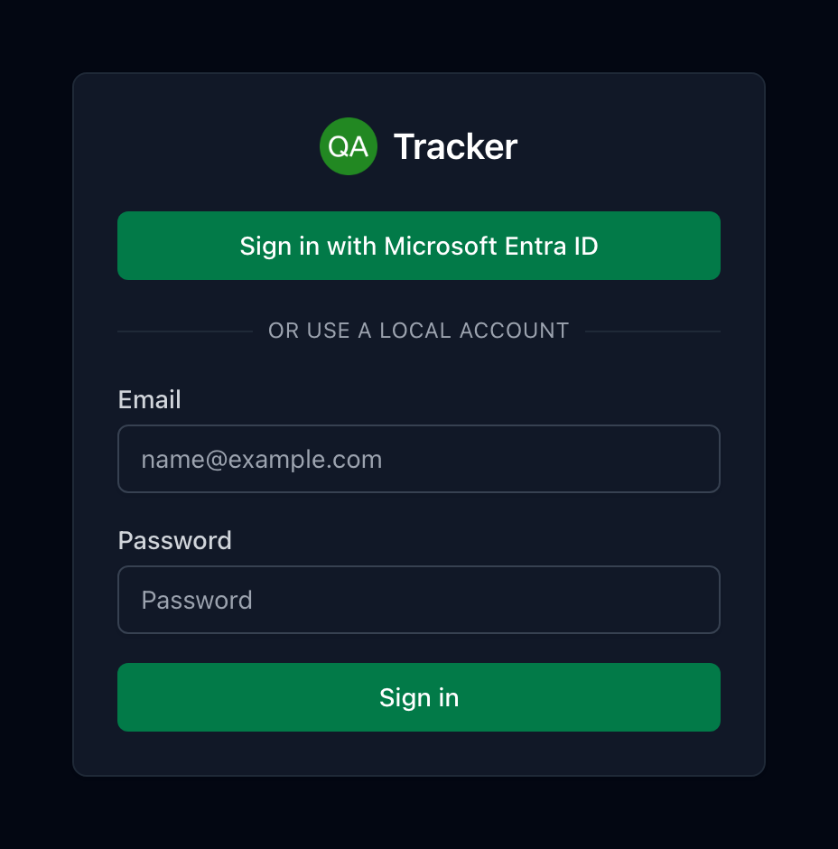
  &nbsp;
  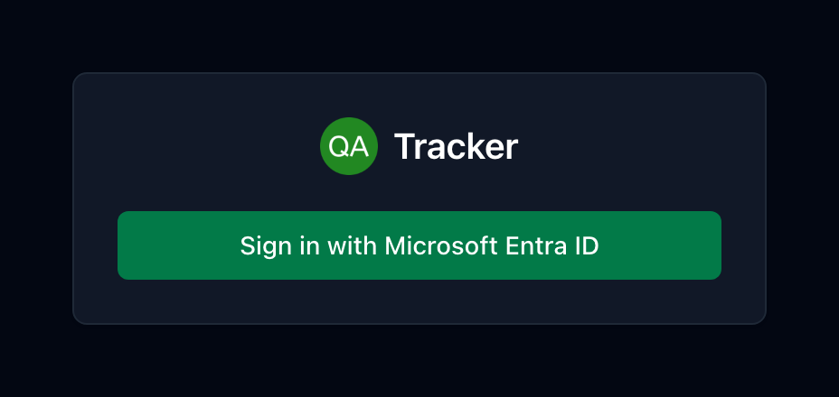
</p>

### Run it yourself

QA leads manage users, see usage and system status, and decide what developers may change.

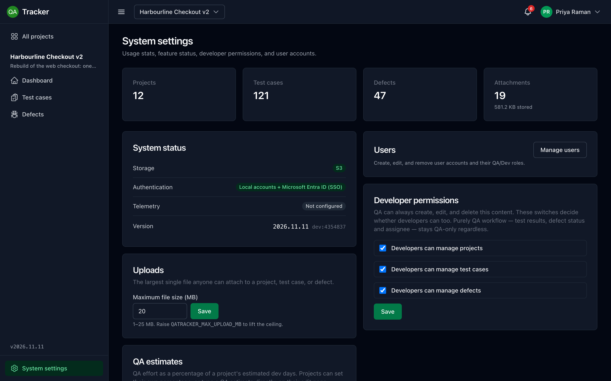

<sub>Every person, company and record in these screenshots is fictional demo data.</sub>

## Try it

You need Docker. Save this as `docker-compose.yml`, change the passwords, and run
`docker compose up -d`:

```yaml
services:
  db:
    image: postgres:17-alpine
    environment:
      POSTGRES_DB: qatracker
      POSTGRES_USER: qatracker
      POSTGRES_PASSWORD: change-me
    volumes:
      - qatracker-db:/var/lib/postgresql/data
    healthcheck:
      test: ["CMD-SHELL", "pg_isready -U qatracker -d qatracker"]
      interval: 5s
      retries: 10

  app:
    image: ghcr.io/mophead64/qa-tracker:latest
    depends_on:
      db:
        condition: service_healthy
    environment:
      QATRACKER_DB_HOST: db
      QATRACKER_DB_PASSWORD: change-me
      QATRACKER_ADMIN_EMAIL: you@example.com
      QATRACKER_ADMIN_PASSWORD: Change-me-1!
    ports:
      - "8080:8080"

volumes:
  qatracker-db:
```

Open <http://localhost:8080> and sign in with the admin email and password. From there,
[Getting started](docs/getting-started.md) covers adding your team, switching on
attachments and connecting single sign-on.

## Documentation

| | |
|---|---|
| [Getting started](docs/getting-started.md) | Run it, sign in, add your team, switch on attachments |
| [User guide](docs/user-guide.md) | A project from start to finish, with screenshots |
| [Features](docs/features.md) | Everything QA Tracker does, area by area |
| [Configuration](docs/configuration.md) | Environment variables |
| [Single sign-on](docs/sso.md) | Microsoft Entra ID and Keycloak setup |
| [Deployment](docs/deployment.md) | Production hosting, scaling, upgrades and monitoring |
| [Development](docs/development.md) | Building from source, tests, and regenerating these screenshots |

## Built with

C# and .NET 10 (Blazor static server-side rendering), PostgreSQL with Entity Framework
Core, ASP.NET Core Identity with OpenID Connect, Tailwind CSS, and Docker.

## License

[MIT](LICENSE)
