[QA Tracker](../README.md) › [Docs](README.md) › User guide

# User guide: a project from start to finish

This guide follows one engagement through QA Tracker: *Harbourline Checkout v2*, a rebuild
of an online shop's checkout. **Priya** leads the testing with **Tom**, and **Marcus**,
**Aisha** and **Liam** are the developers. Testing runs Monday to Friday, and we join on the
Tuesday evening with two days done.

The people, companies and data are fictional, but everything you see is the real app.

1. [Set up the project](#1-set-up-the-project)
2. [Write the test plan](#2-write-the-test-plan)
3. [Run the tests](#3-run-the-tests)
4. [Raise defects](#4-raise-defects)
5. [Fix and verify](#5-fix-and-verify)
6. [Share evidence](#6-share-evidence)
7. [Talk it through](#7-talk-it-through)
8. [Stay on top of it](#8-stay-on-top-of-it)
9. [Wrap up](#9-wrap-up)
10. [Make it yours](#10-make-it-yours)
11. [For admins](#for-admins)

---

## 1. Set up the project

### Create the project

From **All projects**, select **New project**. Only the name is required, and everything
can be changed later.

- **Brief:** one line, shown under the name on the projects page.
- **Notes:** anything the whole team should see on the dashboard, such as environments,
  test accounts or what's out of scope.
- **Testing schedule:** the testing window, with a tick-box for starting or ending at
  midday. Days count weekdays only.
- **Estimates:** the developers' estimate in days, and a QA estimate. Type the QA figure,
  or let QA Tracker work it out as a percentage of the dev days (25% unless you change it).
  Projects show the result as "5 days", or "~3 days" for an estimate.
- **Defect template:** whether new defects start with one description box (*Simple*) or
  separate steps, expected and actual results (*Advanced*).
- **Custom links:** buttons on the dashboard for the staging site, the repository, the
  spec, or a `mailto:` address.

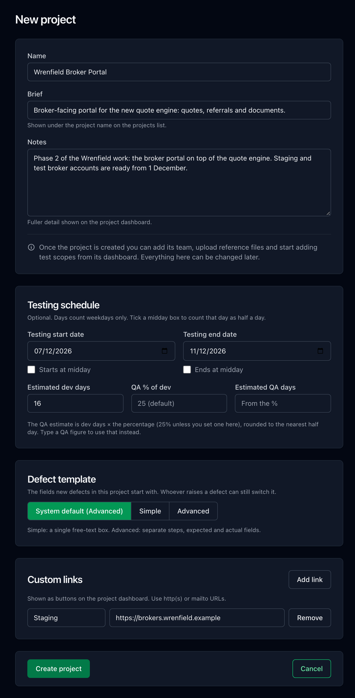

A project starts as **Not Started**. Give it testing dates and it becomes **Upcoming**; it
becomes **Active** as soon as its first scope or defect is added. Mark it **Completed** by hand
when you're done, or **Cancelled** if it isn't going ahead. Completed and cancelled projects only
show when the projects filter is set to everything.

### Add the team

On the project dashboard, select **Add** on the **Team** card and tick the developers and
QAs working on it. The team decides who appears in the assignee picker, who gets
notifications about the project, and whose *Your projects* list it appears on.

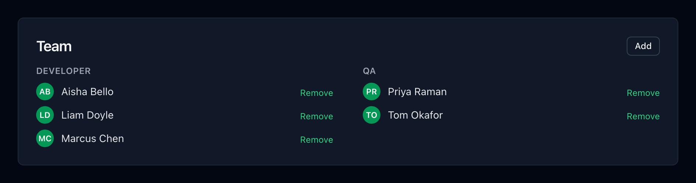

### Tag it

Tags label projects by tech stack, team, client or anything else. On the dashboard, select
**+** under the testing dates. Pick a tag another project already uses, or type a new name and
pick a colour to create it for every project. The **×** on a tag takes it off the project, and selecting a tag's
name opens a small editor to rename, recolour or delete it everywhere. Anyone who can edit the project
can do all of this; everyone else just sees the tags. Tags show beside the
status on **All projects** and in the project switcher, and searching the projects page finds
projects by tag.

## 2. Write the test plan

### Scopes and test cases

A **scope** is an area of testing (*Basket*, *Payment*, *Accessibility*), marked as
**Functional** or **Non-functional**. Test cases live inside scopes, and each has a
scenario and its steps.

- **New scope** and **New test case** create them; select a scope's name to open a page
  for just that scope.
- **Reorder scopes** lets you drag them into order (or use the arrow buttons). New scopes
  go to the bottom.
- A test case can move to another scope from its edit page, keeping its results, comments
  and files.

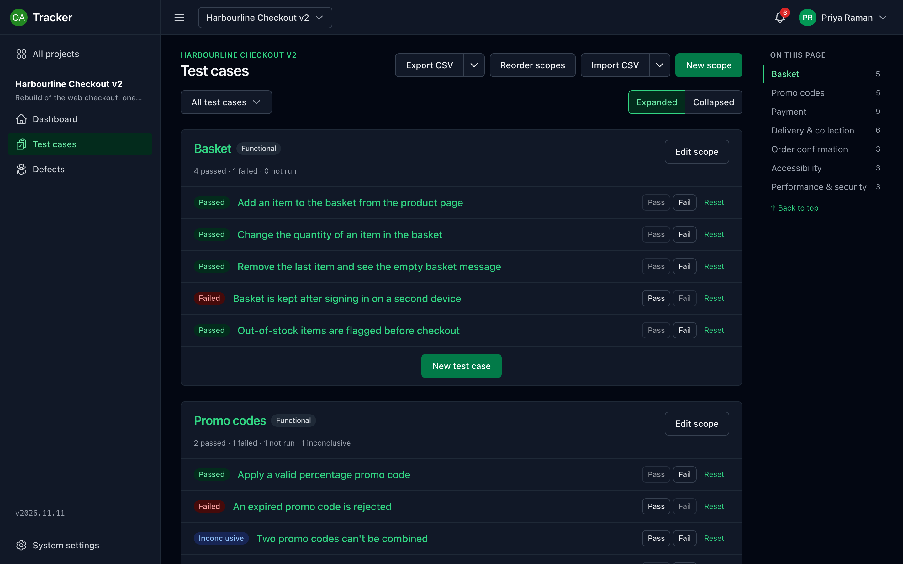

### Import a plan from a spreadsheet

Already have test cases in a spreadsheet? Use **Import CSV**; its menu has **Download
template** to get the column layout. Or select **Export CSV** to get the current plan in the
same format, edit it in any spreadsheet, and import it again.

Choose the file and select **Validate**. QA Tracker compares it with what's already there
and shows only what will change: new scopes, new test cases, and line-by-line differences
in steps. Mistakes such as a scope split across the file are reported before anything is
saved. Nothing changes until you select **Import**.

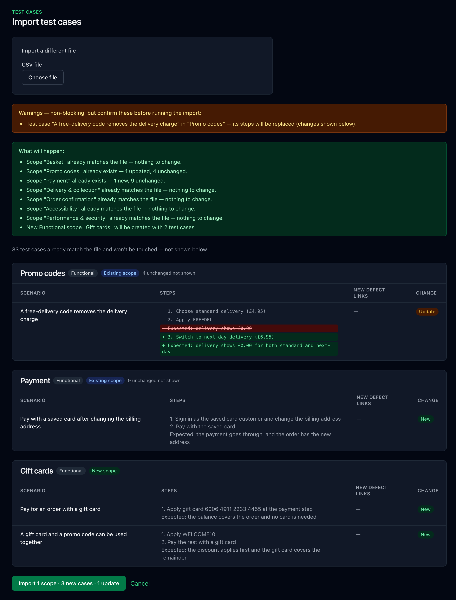

## 3. Run the tests

### Record results

Open a test case to see its steps, then set the result from the menu under its name:

| Result | Use it when |
|---|---|
| **Not run** | Not tested yet — or back to the start |
| **Running** | You've started testing it — the rest of the team can see it's in hand |
| **Passed** / **Failed** | The case ran, and it worked or it didn't |
| **Blocked** | Something else is stopping it from running (an environment, another feature) |
| **Inconclusive** | It ran, but the behaviour needs a decision from the business |

A case that hasn't been run yet also has quick **Mark as running**, **Mark as passed** and
**Mark as failed** buttons beside the menu; once it's running, the pass and fail buttons stay to
finish it. QA Tracker records who set the result and when. **Previous** and **Next** step through the
cases still to do, so you can run the plan without going back to the list. On the plan
itself, **Pass** and **Fail** work straight from each row.

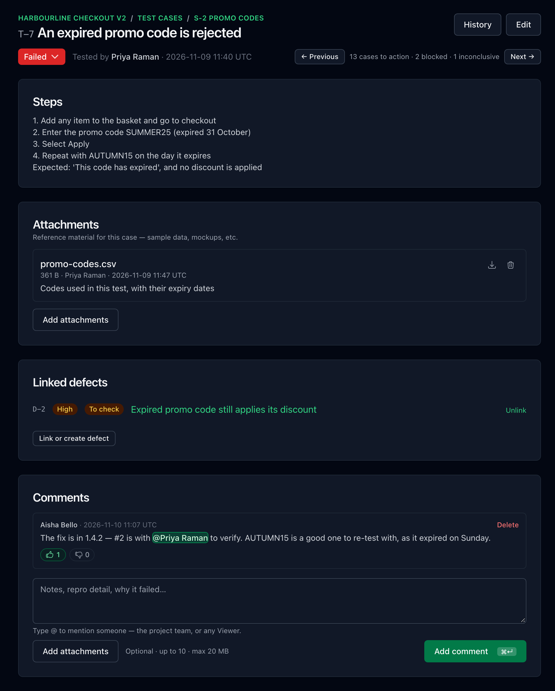

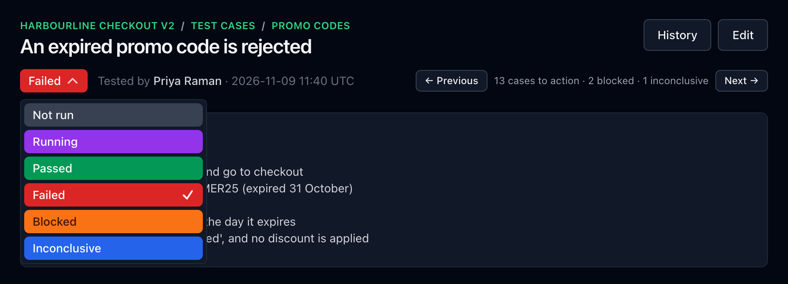

### Find what's left

The filter at the top of the plan narrows it to **Outstanding** cases (not run, running, failed
or blocked) or to one result. Your choice is remembered for every project.

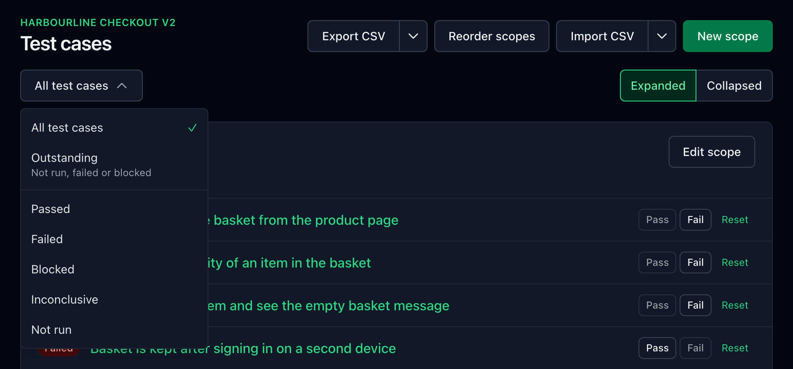

Switch to **Collapsed** to see one row per scope with a coloured progress bar, which is
handy for a daily stand-up.

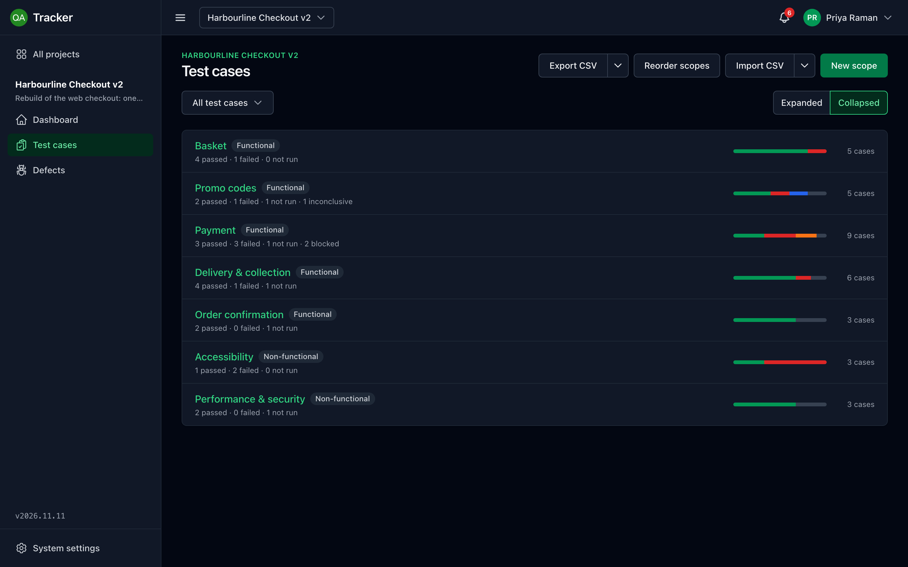

### See what happened

**History** on a test case shows who created and edited it, every change of result, files
added or removed, and defects linked or unlinked.

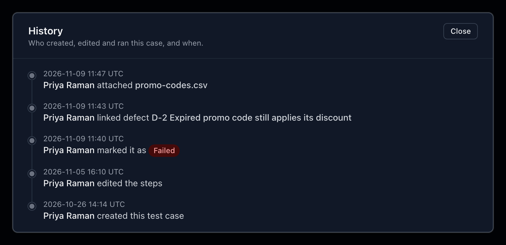

## 4. Raise defects

### From a failed test

On a failed test case, select **Link or create defect**. Tick an existing defect if this
is a bug you already know about, or **Create a new defect instead**. Defects are listed newest
first and start filtered to **Open** ones; switch the filter to see all, closed or a single
status. Anything you've ticked stays ticked when you change it.

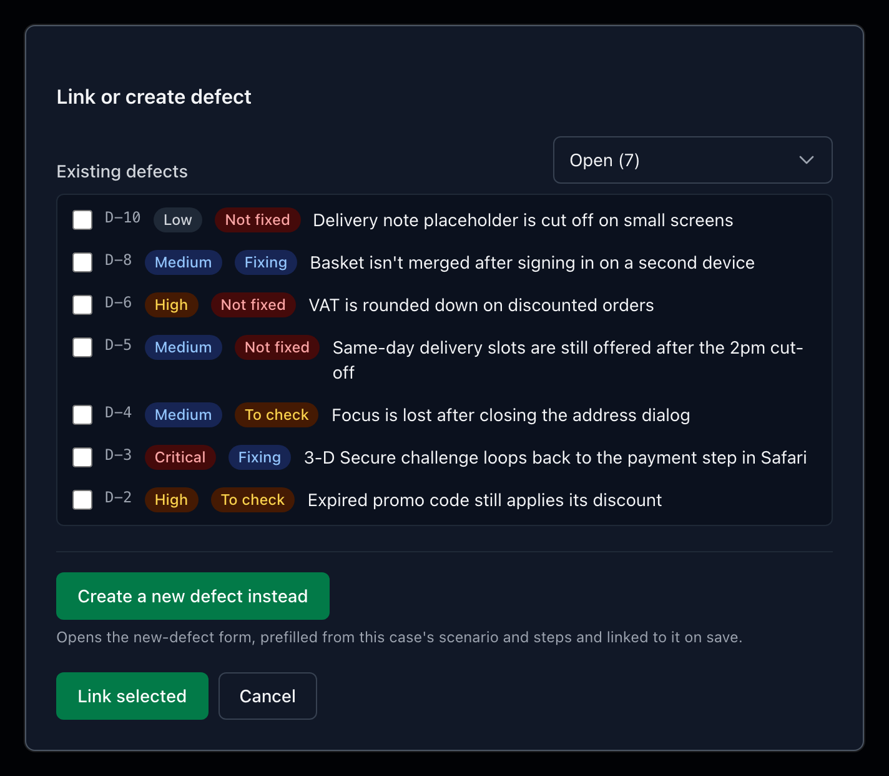

The new defect form starts with the test case's scenario and steps, and links the two when
you save. Pick the **template** (Simple or Advanced) and the **severity** (Low, Medium,
High or Critical). Once it's created you can attach screenshots, link more test cases and
assign it.

**Link test cases** on a defect lists the plan's cases by scope, each scope collapsible (they open
the way you lay scopes out on the test cases page) with **Expand all** / **Collapse all**, a
**Select all** per scope and each case's current result. A scope's name opens that scope's own
page, as it does in the defect's list of linked test cases.

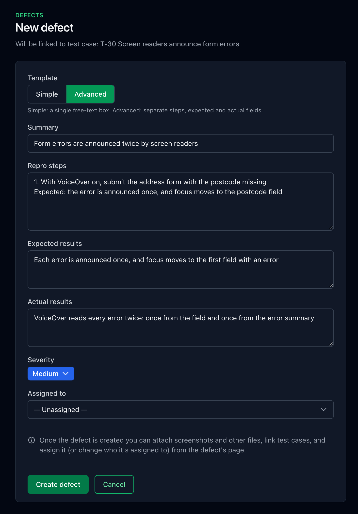

### On its own

Not every bug comes from a test case. **New defect** on the **Defects** page raises one on
its own; link test cases to it later, or create a test case from it.

## 5. Fix and verify

Every defect moves through **Not fixed → Fixing → To check → Fixed** (or **Not a defect**,
when everyone agrees it isn't one), and QA Tracker passes it between people as it goes.

### The defect page

Each defect's page shows its severity, status and assignee, then the repro steps, expected
and actual results, files, linked test cases (with their current results) and comments:

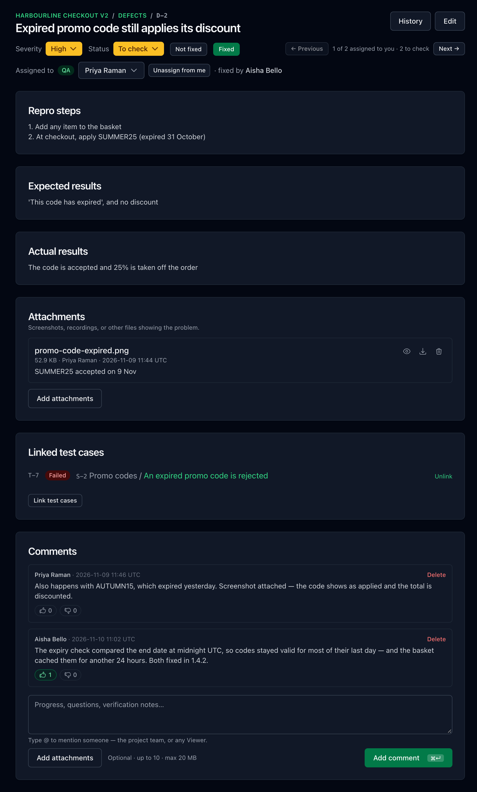

### Developers: Start fixing, Mark as fixed

Marcus opens a defect assigned to him. **Start fixing** moves it to *Fixing*. When the fix
is deployed, **Mark as fixed** moves it to *To check* and hands it to a QA on the team, who
gets a notification.

**Previous** and **Next** step through everything assigned to him that still needs work,
most severe first, with a count of what's left.

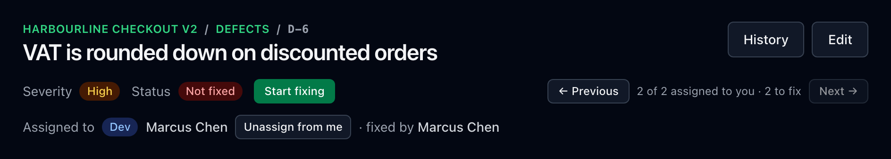

### QAs: Fixed or Not fixed

Priya re-tests. **Fixed** closes the defect and records her as the tester. **Not fixed**
sends it straight back to the developer who fixed it, and tells them.

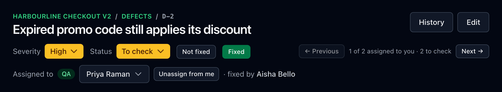

### Every step on record

**History** on a defect shows each status change, assignment, edit, linked test case and
file, with who did it and when:

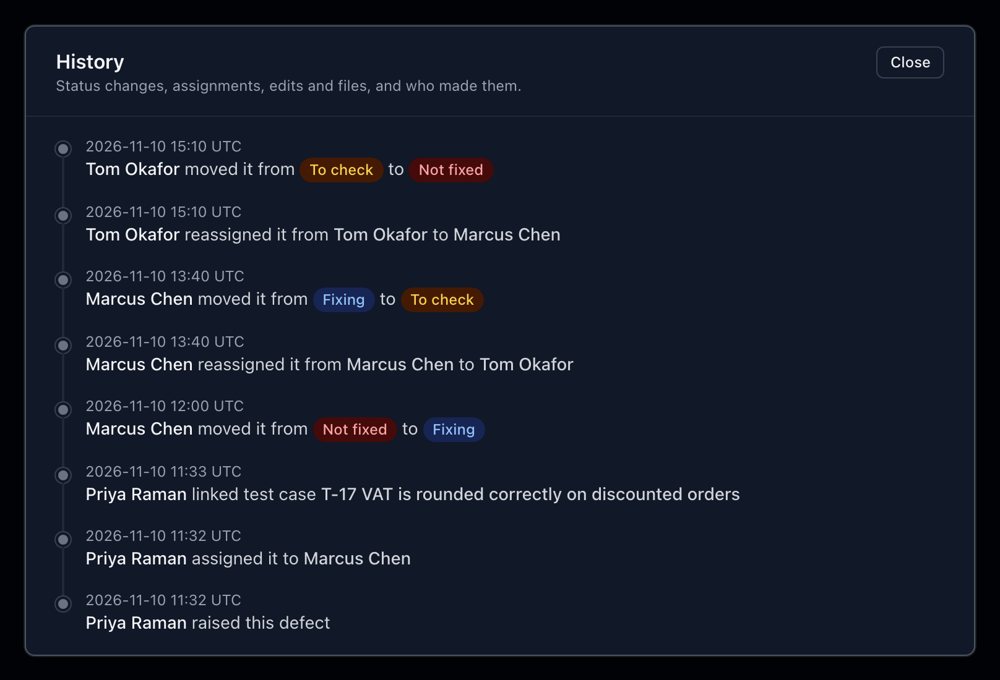

### The defects page

Defects are grouped by what they need from you: **To verify** or **To fix** (assigned to
you), **Unassigned**, **Other open defects** and **Closed**, most severe first. The filter
narrows the page to open, closed, or one status.

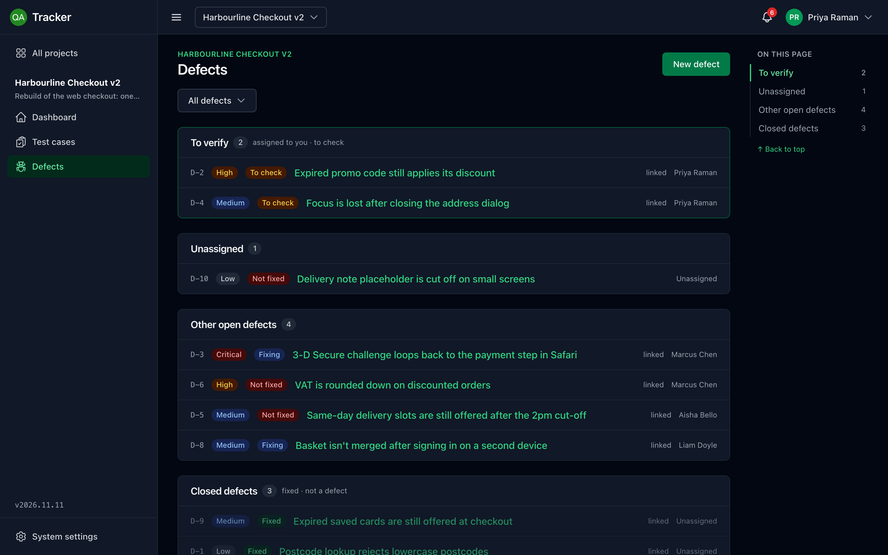

## 6. Share evidence

Projects, test cases, defects and comments can all have files: screenshots, screen
recordings, logs, HAR files, PDFs. **Add attachments** opens a window where you pick several
files at once, check them, add a description and upload.

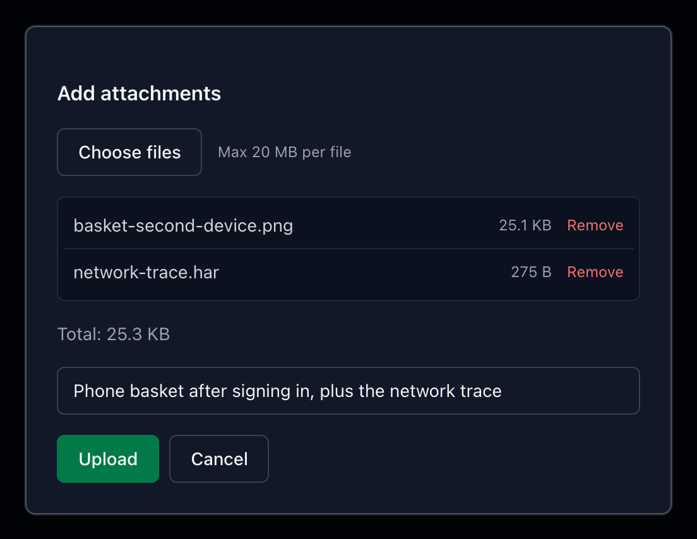

Select a file's name, or the eye icon, to preview it without downloading. Images, video,
audio and PDFs open in the app; anything else downloads.

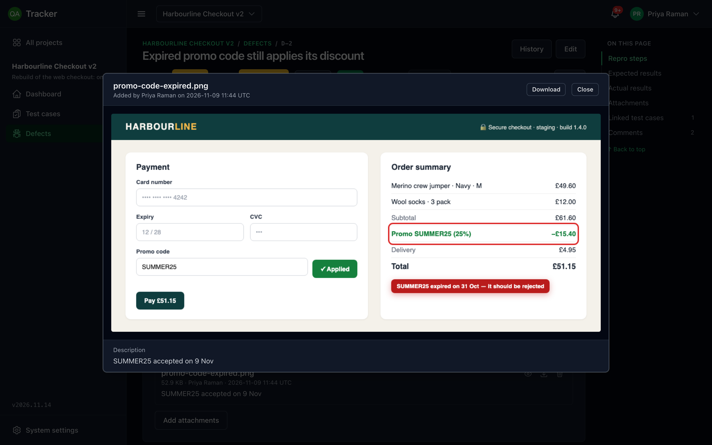

## 7. Talk it through

### Comments, mentions and reactions

Projects, test cases and defects each have their own comments. Type **@** to mention a team
member, and they're notified. Give a comment a thumbs up or down, and hover over the count
to see who reacted. Long threads are split into pages of five, starting with the newest,
and **Ctrl+Enter** (**⌘+Enter** on a Mac) posts.

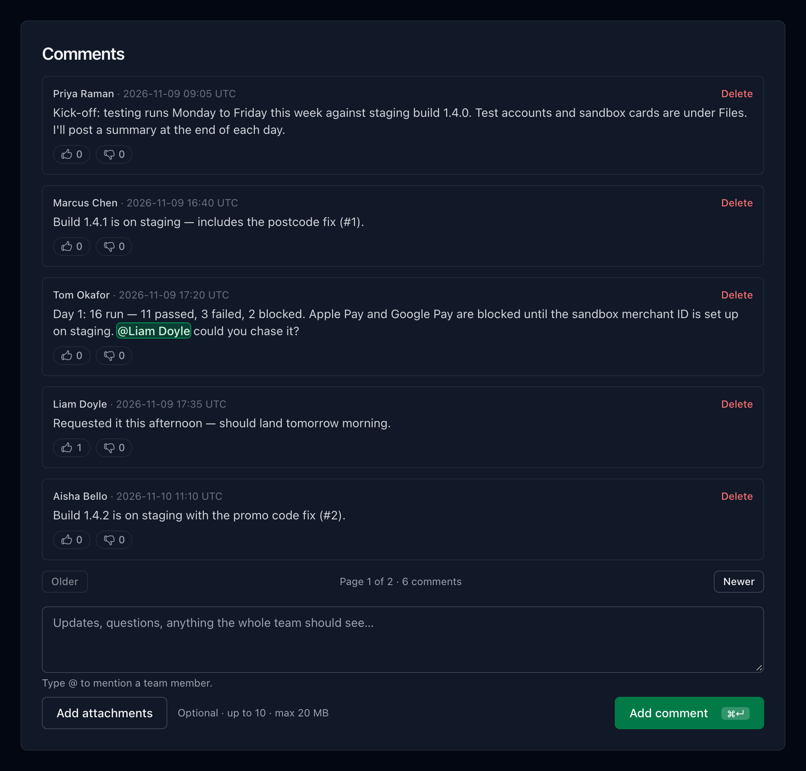

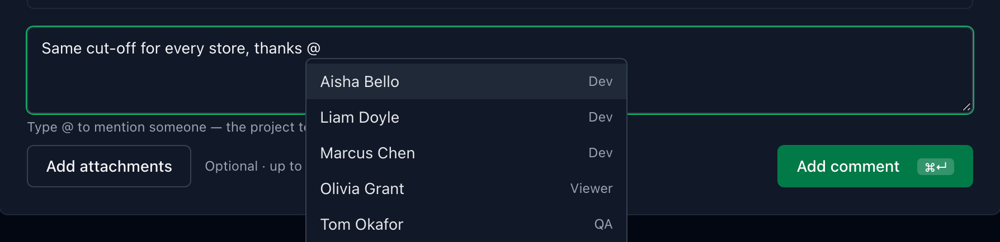

### Notifications

The bell in the top bar collects what concerns you, by default:

- a defect assigned to you, or taken off you
- your defect's status changing (handed to you to check, a fix sent back as not fixed), new
  comments, files and edits on it
- comments on, and result changes to, test cases you tested
- @mentions, and reactions to your comments
- being added to or removed from a project's team
- a new defect on one of your projects (developers only, unless you switch it on)

Choose which of these you want under **Notifications** in **Settings**.

A badge counts unread items, a pop-up appears when something new arrives, and an optional
sound plays (choose it in **Settings**). Clear notifications one by one, or all at once.

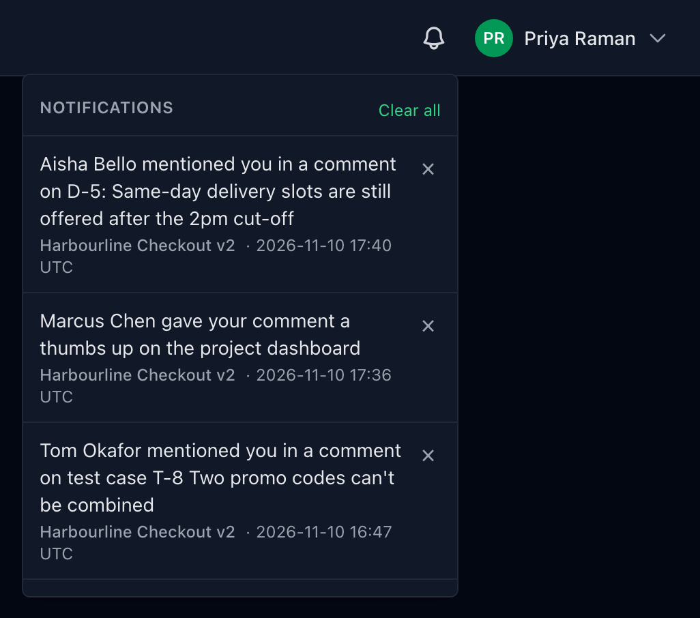

## 8. Stay on top of it

### The dashboard

Each project's dashboard has its results, open defects, testing window and estimates,
links, notes, team, files and comments. The **On this page** panel on the right jumps
between them.

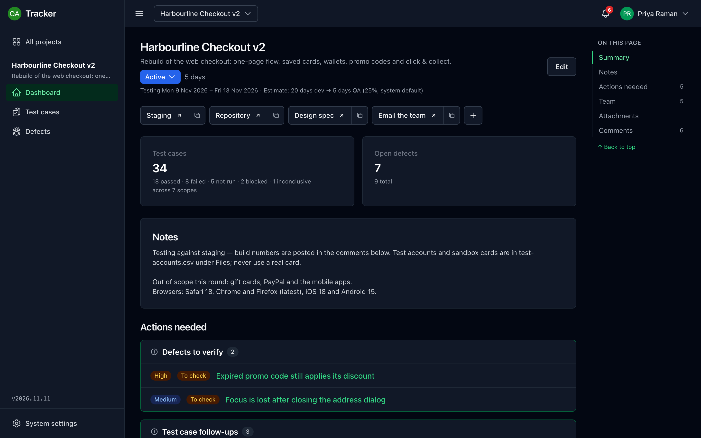

**Actions needed** appears when something is waiting:

- **Defects to verify** or **Defects to fix**: assigned to you.
- **Failed, no defect raised**: failed test cases nobody has raised a defect for yet.
- **Ready to retest**: failed test cases whose linked defects are now all closed.
- **Passed, open defect**: passed test cases that still have an open defect linked.

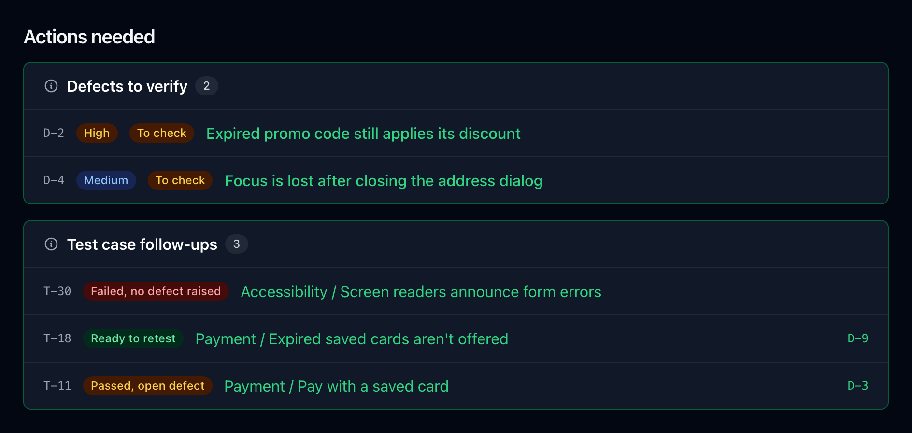

**Recent activity** shows the last five things that happened: test cases created and run,
defects raised, moved through the workflow and assigned, and changes to the project itself
(status, team, tags, scopes, files and imports). **View all activity** opens the whole feed, which
you can narrow to the project, test cases or defects and page back through with **Load more**.
Deleted test cases, defects and scopes are listed there too.

### All projects

**All projects** shows *Your projects* first (the ones you're on the team for, with how many
actions need you), then the rest by status. Each row shows the project's status, tags, testing
dates and days; active projects also show their test results and open defects (red: not fixed
or fixing; amber: waiting to be verified). Active and upcoming projects are listed soonest testing start first. The filter shows active projects, active and
upcoming ones, or everything including completed work. The project switcher in the top
bar changes which project the side navigation points at. It groups projects the same way (active,
upcoming, not started, completed, cancelled), and once there are more than a handful you can type to
find one by name, brief or tag: ↓ and ↑ move through the matches and Enter opens the first.

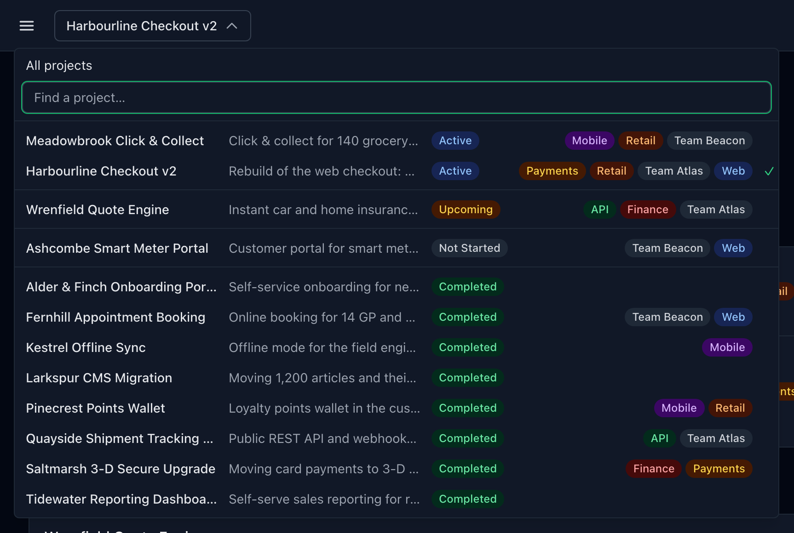

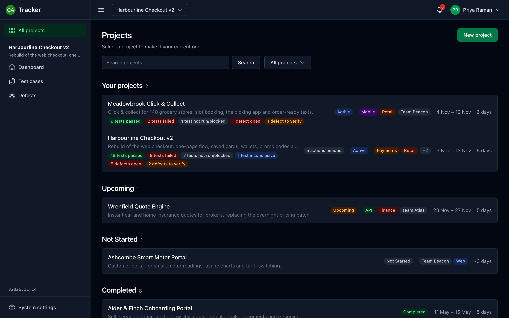

## 9. Wrap up

- **Export CSV → Export with results** gives you the plan with each case's result, tester
  and date, ready to attach to a sign-off report. It can still be re-imported.
- Use the status menu next to the project's name on the dashboard to mark it
  **Completed**. It moves to the *Completed* group, with its history kept.
- Deleting a project lives in the **Danger zone** at the bottom of its edit page. You'll be
  shown what goes with it and asked to type the project's name.

## 10. Make it yours

**Settings** (from the menu under your name) has:

- **Appearance:** System, Light or Dark.
- **Notification sound:** on or off, which sound (with a preview), and how loud.
- **Notifications:** what you're told about, grouped by area: someone assigning you a defect or
  taking you off one, changing its status, commenting, adding a file or editing it; someone
  commenting on or changing the result of a test case you tested; mentions and reactions to your
  comments; and being added to or removed from a project's team. Everything starts on, except
  new defects on your projects (on for developers). **Reset to defaults** puts it back. You're
  never told about your own actions.
- **Account:** your email, sign-in method, last sign-in and role. Local accounts can change
  their email and password here; single sign-on accounts are managed by your identity
  provider.

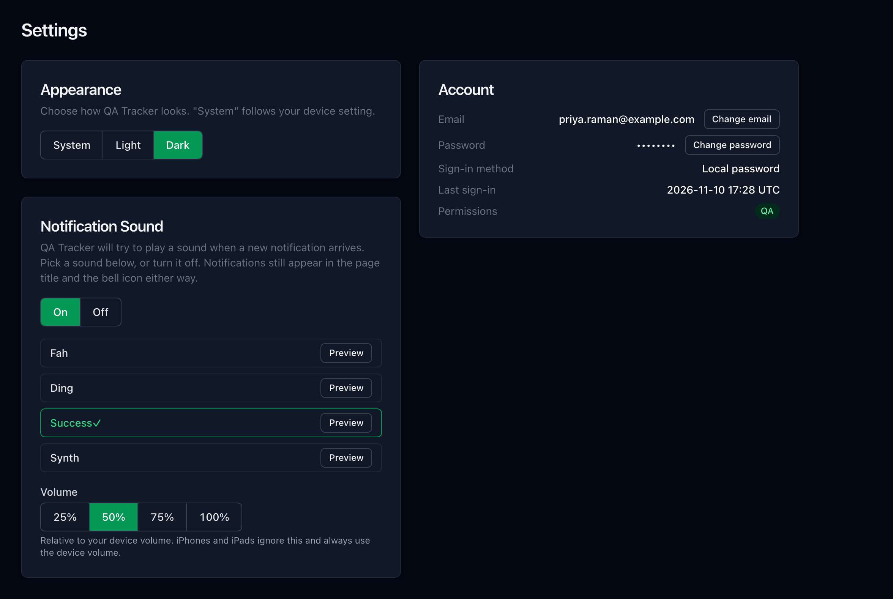

## For admins

QAs see **System settings** at the bottom of the side navigation.

- **Usage:** projects, test cases, defects, and attachments with the storage they use.
- **System status:** the storage and sign-in setup, telemetry, and the running version,
  with a check for updates.
- **Uploads:** the largest file anyone can attach.
- **Developer permissions:** whether developers can create, edit and delete projects, test
  cases and defects; with defects, that includes reassigning them from the defect page. Test
  results and defect status stay with QAs.
- **QA estimates** and **Defect template:** the defaults new projects start with.

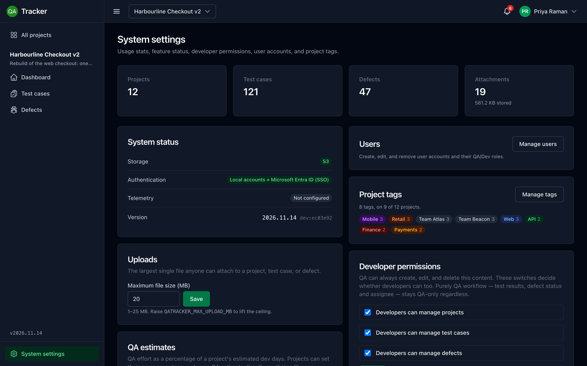

**Project tags** lists every tag with how many projects use it and how many of those are
active; select **Used on x projects** to see which ones. You can create tags here; select a tag's name to rename, recolour or delete it.
Renaming or deleting a tag is recorded in the history of every project it's on.

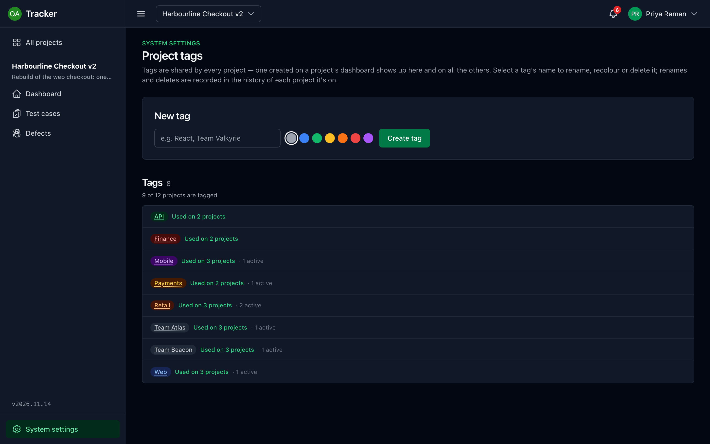

**Users** lists everyone with their role and last sign-in. Deleting someone takes them off every
team and unassigns their defects; anything they created, commented on or recorded stays, shown as
"Deleted user", and their email address is free to use for a new account. Accounts created by single
sign-on carry an **SSO** badge, and their name and role come from the identity provider.

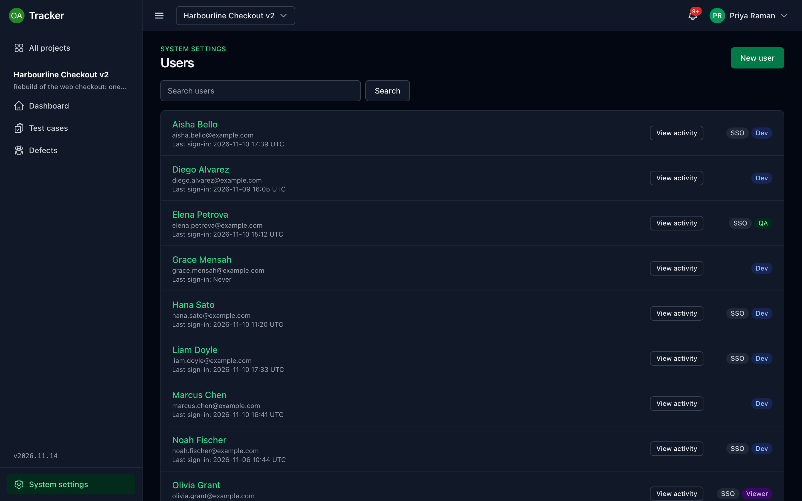

---

Next: [Features](features.md) · Back to the [documentation index](README.md)
